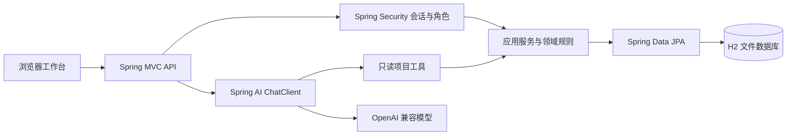

# FlowWise 架构说明

## 技术选型

- Java 25、Spring Boot 3.5、Spring Framework 6、Jakarta Persistence/Validation。
- Spring MVC 提供 REST API；Spring Security 负责会话登录、CSRF 与角色/方法权限。
- Spring Data JPA + Hibernate 负责持久化；本地默认使用 H2 文件数据库。
- Spring AI 1.1 的 ChatClient + `@Tool` 实现只读项目 Agent；OpenAI API 或兼容接口通过环境变量配置。
- Actuator 暴露健康与基础信息端点；前端为服务端静态资源，使用原生 HTML/CSS/JavaScript。

## 分层与数据流

`api` 负责 HTTP 输入校验和响应；`service` 执行业务规则与对象级授权；`domain` 保存实体状态；`repository` 封装查询；`agent` 包含模型交互、工具定义和配置。Agent 工具再调用 service，因此 AI 查询服从与页面 API 相同的角色边界。

## 项目与交付流程

1. 管理员或项目经理提交项目新建/变更申请，管理员审批后项目才生效；删除以归档实现，保留历史任务。
2. 项目负责人或管理员创建任务并分派给已启用成员。
3. 任务成员开始任务后，提交交付说明或链接，任务进入 `REVIEW`。
4. 管理员或该项目负责人验收，通过后进入 `DONE`；驳回后退回进行中，可再次提交。
5. 关键动作写入活动记录，页面定时刷新工作区数据。

## 权限和 Agent 安全边界

| 数据/操作 | 管理员 | 项目经理 | 成员 |
| --- | --- | --- | --- |
| 项目数据 | 全部有效项目 | 自己负责的有效项目 | 有本人任务的项目 |
| 任务数据 | 全部 | 自己项目中的任务 | 指派给本人的任务 |
| Agent 工具 | 查询全部可见任务 | 查询自己项目任务 | 查询本人任务 |
| 写操作与审批 | 按现有管理规则 | 按负责项目规则 | 仅本人任务开始和交付 |

模型只收到用户问题和工具定义，不收到工具上下文中的 username/roles。身份和角色从当前已认证会话读取，再由应用服务执行可见范围过滤。当前 Agent 只有只读查询工具，没有创建、修改、删除或审批工具；模型输出不应作为授权依据。

## 当前限制与后续演进

- 单体部署适合当前演示和小型团队；服务拆分要等部署、团队和负载边界明确后再做。
- 本地 H2 用于开箱运行；实际部署需迁移 PostgreSQL/MySQL，并用 Flyway 管理 schema 版本。`ddl-auto=update` 不适合作为生产迁移策略。
- 现有角色范围依据项目负责人和任务指派判断；后续可补充显式项目成员、租户隔离和更细粒度的策略授权。
- Agent 目前是单轮问答，无长期记忆、RAG、Agent 评估集或写操作确认；接入生产前要增加限流、超时/重试、脱敏、审计、成本监控和基于真实问题的评测。
- 模型调用会把用户问题及工具返回的可见任务摘要发送给配置的模型服务商；接入前应确认数据处理与隐私要求。
